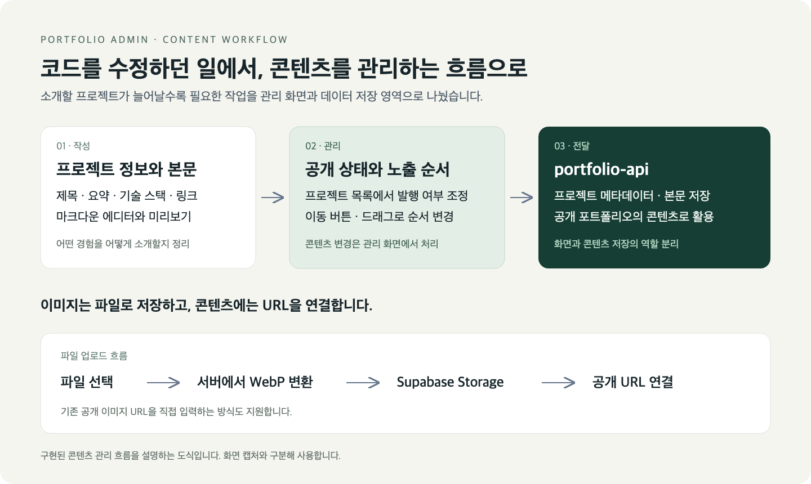
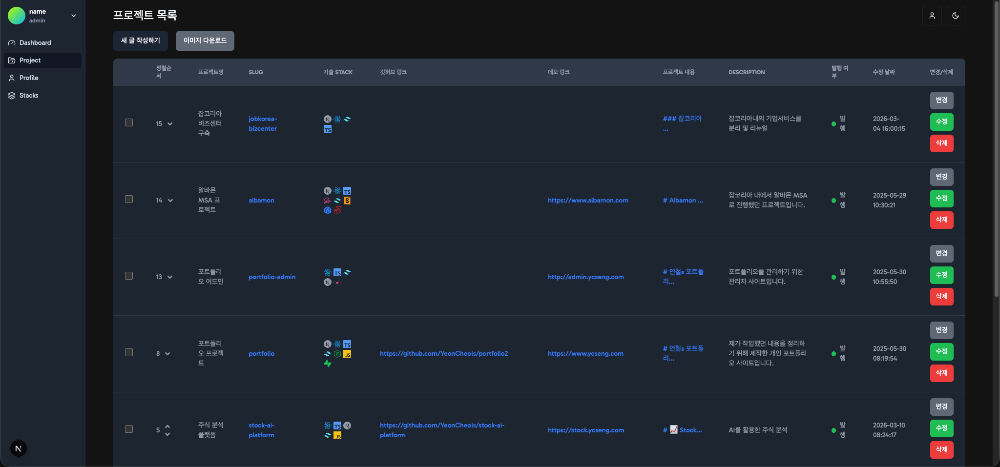
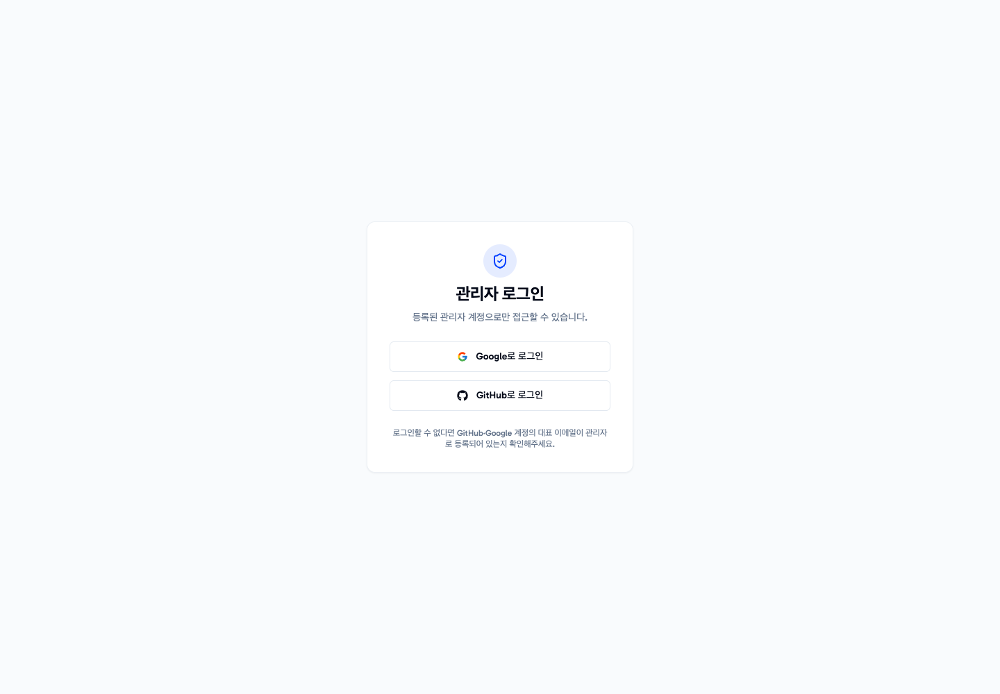

```json
{
  "schemaVersion": 1,
  "slug": "portfolio-admin",
  "title": "포트폴리오 관리자",
  "description": "프로젝트·프로필·기술 스택을 관리하고 마크다운 본문과 이미지를 편집하는 Next.js 기반 관리자 대시보드입니다. 별도의 포트폴리오 API와 연동해 콘텐츠 관리 작업을 한곳에 모았습니다.",
  "stacks": [
    "Next.js",
    "React",
    "TypeScript",
    "Tailwind CSS",
    "SWR",
    "Zustand",
    "React Hook Form",
    "Supabase",
    "VisActor"
  ],
  "linkDemo": "https://admin.ycseng.com",
  "linkGithub": "https://github.com/side-projects-labs/portfolio-admin"
}
```

# 포트폴리오 관리자

## 목차

- [🧭 코드 수정에서 콘텐츠 관리로](#-%EC%BD%94%EB%93%9C-%EC%88%98%EC%A0%95%EC%97%90%EC%84%9C-%EC%BD%98%ED%85%90%EC%B8%A0-%EA%B4%80%EB%A6%AC%EB%A1%9C)
- [🗂️ 관리 화면에서 다루는 작업](#%EF%B8%8F-%EA%B4%80%EB%A6%AC-%ED%99%94%EB%A9%B4%EC%97%90%EC%84%9C-%EB%8B%A4%EB%A3%A8%EB%8A%94-%EC%9E%91%EC%97%85)
- [✍️ 콘텐츠를 작성하고 공개하기까지](#%EF%B8%8F-%EC%BD%98%ED%85%90%EC%B8%A0%EB%A5%BC-%EC%9E%91%EC%84%B1%ED%95%98%EA%B3%A0-%EA%B3%B5%EA%B0%9C%ED%95%98%EA%B8%B0%EA%B9%8C%EC%A7%80)
- [🛠️ 구조와 구현 선택](#%EF%B8%8F-%EA%B5%AC%EC%A1%B0%EC%99%80-%EA%B5%AC%ED%98%84-%EC%84%A0%ED%83%9D)
- [🌱 콘텐츠와 함께 확장할 관리 공간](#-%EC%BD%98%ED%85%90%EC%B8%A0%EC%99%80-%ED%95%A8%EA%BB%98-%ED%99%95%EC%9E%A5%ED%95%A0-%EA%B4%80%EB%A6%AC-%EA%B3%B5%EA%B0%84)

나만의 포트폴리오를 만들면서, 직접 사용한 기술과 그 과정에서 내린 선택을 풀어낼 공간이 필요했습니다. 포트폴리오 웹앱을 구축하면서 프로젝트를 소개할 공간은 마련했지만, 콘텐츠를 추가하고 다듬을 때마다 코드를 수정해야 했습니다. 프로젝트가 늘어날수록 수동으로 변경해야 하는 범위도 함께 커졌습니다.

## 🧭 코드 수정에서 콘텐츠 관리로

프로젝트를 어떤 이미지로 보여줄지, 기술 스택과 본문을 어떻게 연결할지, 어떤 순서로 공개할지를 지속적으로 관리할 방법이 필요했습니다. 앞으로 소개할 프로젝트와 콘텐츠를 확장하려면, 이러한 작업을 담당하는 관리 페이지가 필요하다고 판단했습니다.

이런 배경에서 포트폴리오 어드민을 만들었습니다. 프로젝트 정보와 마크다운 본문, 이미지, 기술 스택을 화면에서 편집하고 공개 상태와 노출 순서를 조정할 수 있도록 구성했습니다. 콘텐츠를 갱신할 때 필요한 코드 수정을 줄이고, 프로젝트의 경험과 기술적인 이야기를 정리하는 데 집중하는 것이 목적이었습니다.

화면의 기능이나 표현 방식을 바꿀 때는 코드를 수정하되, 프로젝트를 추가하거나 소개 내용을 다듬는 일은 관리 화면에서 처리할 수 있도록 작업의 경계를 나눴습니다. 공개 포트폴리오는 콘텐츠를 보여주는 공간으로, 어드민은 그 콘텐츠를 작성하고 관리하는 공간으로 구성했습니다.



*프로젝트를 작성해 공개 상태를 관리하는 흐름과, 이미지 파일·콘텐츠 저장의 역할을 구분했습니다.*

## 🗂️ 관리 화면에서 다루는 작업

포트폴리오의 콘텐츠는 본문만으로 구성되지 않습니다. 프로젝트마다 제목과 요약, 주소 식별자, 대표 이미지, 기술 스택, 배포·저장소 링크가 필요하고, 어떤 프로젝트를 먼저 보여줄지도 관리해야 합니다. 이 앱은 이런 항목을 각각의 관리 화면과 편집 흐름으로 나눠 다룹니다.

기본적인 작업 흐름은 다음과 같습니다.

1. 관리자 로그인 화면에서 OAuth 인증을 시작합니다.
2. 프로젝트 기본 정보를 입력하고 slug 중복 여부를 확인합니다.
3. 대표 이미지와 기술 스택, 배포·저장소 링크를 연결합니다.
4. 별도 에디터에서 마크다운 본문을 작성하고 미리보기로 내용을 확인합니다.
5. 목록 화면에서 발행 여부와 노출 순서를 조정합니다.

프로필과 기술 스택은 프로젝트 본문과 별도의 데이터로 관리합니다. 반복해서 사용하는 정보를 관리 화면에 모으고, 프로젝트 입력과 미리보기에서 다시 사용할 수 있도록 구성했습니다.

## ✍️ 콘텐츠를 작성하고 공개하기까지

### 프로젝트 등록부터 공개 상태 관리까지

프로젝트 생성·수정 화면에서 제목, slug, 설명, 기술 스택, 이미지, 외부 링크를 입력합니다. React Hook Form으로 입력 상태와 필드별 검증 메시지를 관리하고, slug 중복 확인 결과를 별도로 표시합니다.

목록은 페이지 단위로 조회하며, 각 항목의 발행·미발행 상태를 바꾸거나 삭제할 수 있습니다. 노출 순서는 위·아래 이동 버튼과 드래그로 변경합니다. 변경 요청 후에는 관련 목록 데이터를 다시 검증해 관리 화면에 반영합니다.



*로컬에서 실행한 ADMIN의 실제 목록 화면입니다. 프로젝트 정보와 기술 스택, 발행 상태, 순서 조정 기능을 한곳에서 확인합니다.*

### 본문 작성과 미리보기

프로젝트를 짧게 소개하는 정보와 개발 과정을 길게 풀어내는 글은 작성할 때 다루는 내용이 다릅니다. 기본 정보와 본문을 작성하는 화면을 분리해, 제목·요약·링크를 관리하는 흐름과 긴 글을 편집하는 흐름을 구분했습니다. 본문 에디터는 마크다운을 입력받고, 미리보기 화면에서는 제목·이미지·기술 스택과 본문을 함께 확인합니다.

본문 렌더링에는 React Markdown과 GFM 확장을 사용합니다. 표, 목록, 인용문, 링크와 코드 블록을 표현하며, 별도의 코드 렌더링 컴포넌트로 하이라이팅을 처리합니다. 기술 스택은 이름뿐 아니라 등록된 아이콘과 색상 메타데이터를 함께 사용합니다.

### 작성 내용의 맞춤법 검사

에디터에서 작성한 내용을 맞춤법 검사 화면으로 전달할 수 있습니다. 서버의 맞춤법 검사 경로에 마크다운 형식을 유지한 교정을 요청하고, 화면에서는 교정된 텍스트와 오류 항목, 개선 제안을 보여줍니다.

교정 결과에는 복사 기능을 제공해 작성자가 내용을 확인한 뒤 편집에 활용할 수 있도록 했습니다. 외부 교정 서비스 호출은 서버 경로를 통해 처리합니다.

### 이미지 업로드와 저장 경로 분리

대표 이미지는 기존 공개 URL을 입력하거나 파일을 업로드하는 방식으로 지정합니다. 파일 업로드 시에는 서버 측에서 WebP로 변환하고 Supabase Storage에 저장한 뒤, 업로드 결과의 공개 URL을 프로젝트 또는 프로필 정보에 연결합니다.

이미지 파일 자체와 프로젝트 메타데이터의 저장을 구분했습니다. 콘텐츠 저장 API에는 파일 본문을 중복으로 넣지 않고 이미지 URL을 전달하는 구조입니다.

### 프로필과 기술 스택 관리

프로필 화면에서는 항목을 생성·수정하고 사용할 프로필을 활성화합니다. 프로필 이미지도 파일 업로드와 URL 입력 흐름으로 다룹니다.

기술 스택 화면은 이름·아이콘·색상·분류 정보를 관리합니다. 같은 메타데이터를 프로젝트 입력과 미리보기에서 사용해 스택 표현을 연결했습니다.

## 🛠️ 구조와 구현 선택

### 관리자 UI와 데이터 API의 역할 분리

Next.js App Router가 관리자 화면과 API 중계 경로를 구성하고, 별도의 portfolio-api가 포트폴리오 콘텐츠 저장과 관리자 인증을 담당합니다. 관리자 UI는 데이터 모델을 별도로 복제하는 대신 API 요청·응답 타입에 맞춰 조회와 편집 화면을 연결합니다.

브라우저 화면에서는 SWR로 목록과 상세 정보를 조회하고, 수정 이후 관련 캐시를 갱신합니다. 폼 입력은 React Hook Form으로, 목록 조작과 화면 간 작성 내용 전달 등 공유 상태는 Zustand 등의 기존 상태 모듈로 처리합니다.

### 인증과 로그인 후 복귀

Google·GitHub OAuth 시작 주소로 이동해 외부 API의 인증 흐름을 사용하고, 앱에서는 쿠키에 기반한 페이지 접근과 로그인 상태를 확인합니다. 로그인 뒤 돌아갈 주소는 내부 경로로 제한해 외부 주소나 잘못된 경로가 복귀 대상으로 사용되지 않도록 검증합니다.



*로컬에서 실행한 ADMIN의 실제 로그인 화면입니다.*

### 일관된 관리 화면

Tailwind CSS와 공통 UI 컴포넌트로 폼·테이블·모달·탐색 메뉴를 구성했습니다. 포트폴리오 공통 UI 패키지의 스택 아이콘과 태그를 재사용하고, 다크 모드와 화면 크기에 따른 레이아웃을 지원합니다.

대시보드에는 VisActor와 정적 예시 데이터를 사용하는 차트 UI를 포함합니다. 콘텐츠 관리 기능과 차트 표현을 같은 관리 화면 구성 안에서 다룹니다.

## 🌱 콘텐츠와 함께 확장할 관리 공간

Vitest와 React Testing Library를 이용한 로그인 UI·오류 안내·복귀 경로·미들웨어 테스트가 구성돼 있습니다. API 타입과 재사용 UI, 데이터 요청 모듈을 바탕으로 관리 기능을 추가하고, 콘텐츠 구조가 바뀌면 입력 화면과 미리보기의 연결도 함께 유지하는 방식으로 구성했습니다.

포트폴리오 웹앱으로 프로젝트를 보여줄 공간을 마련했다면, 어드민에서는 그 공간을 계속 채워 나갈 편집 흐름을 구성했습니다. 프로젝트 정보·본문·이미지·공개 순서를 화면에서 관리할 수 있게 된 것이 이번 구현의 결과입니다. 관리 화면이 늘어나더라도 실제 콘텐츠를 저장하는 API와 화면의 역할을 유지하며 확장할 수 있도록 구성했습니다.
